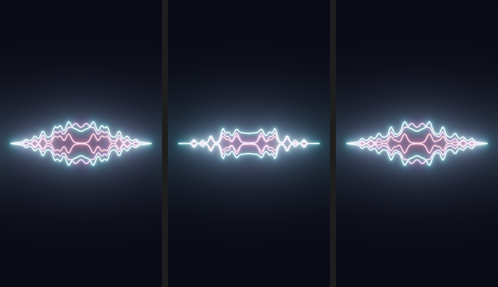

# Zyvrok Audio Visualizers

Free, audio-reactive visualizers for **Blender 5**. Pick a song, run one script, render a video.

## Styles

| Style | Script | Look |
|---|---|---|
| Wave | `blender/scripts/wave_visualizer.py` | Glowing neon wave with echo lines, mirrored up and down, bass in the centre |

## Quick start

1. Open **Blender 5** and go to the **Scripting** tab.
2. Click **Open** and choose `blender/scripts/wave_visualizer.py`.
3. At the top of the script, set `AUDIO_PATH` to your song, for example `r"C:\Music\my_song.mp3"`.
4. Click **Run Script** (or press Alt+P).
5. Press **Space** in the viewport to preview, then **Render → Render Animation** (Ctrl+F12).

You get an MP4 with your song already in it, in a `renders` folder next to your .blend file.
By default it's **1080x1920** (Reels / Shorts / TikTok). Set `VERTICAL = False` for 1920x1080 (YouTube).

More detail in [blender/README.md](blender/README.md).

## Customise

Everything is in the **SETTINGS** block at the top of the script:

- `LAYERS`: colours, height, echo delay and glow of each line
- `WAVE_HEIGHT`, `WAVE_WIDTH`, `THICKNESS`: size of the wave
- `SMOOTHING`: jumpy vs smooth movement
- `BANDS`: how many peaks the wave has
- `LOGO_PATH`: optional PNG logo above the wave
- `MIRROR`, `BASS_IN_CENTER`, `GLOW`: on/off switches

Ready-made colour palettes are in [presets/colors.md](presets/colors.md).

## How it works

The script reads the song, splits it into frequency bands frame by frame, and bakes those levels into a small image inside the .blend file. A Geometry Nodes setup reads that image on every frame to shape the wave. No add-ons needed.
Full explanation: [docs/how-it-works.md](docs/how-it-works.md).

## Licence

MIT: free for personal and commercial use. Please keep the Zyvrok credit in the script.
Only use music you have the rights to.

---

Made by **Zyvrok** · 3D & VFX
